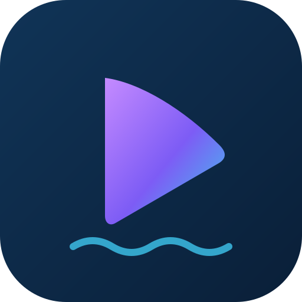
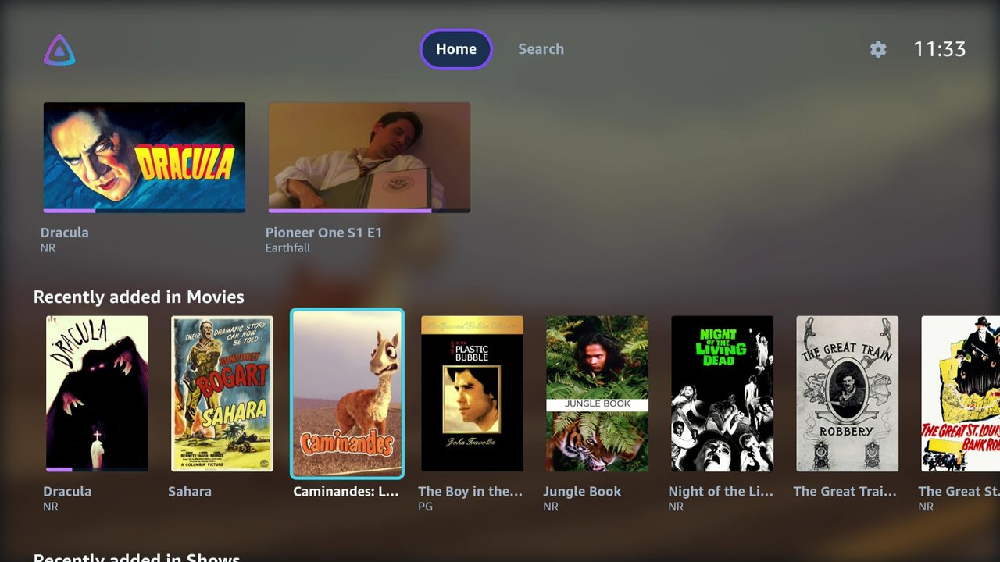
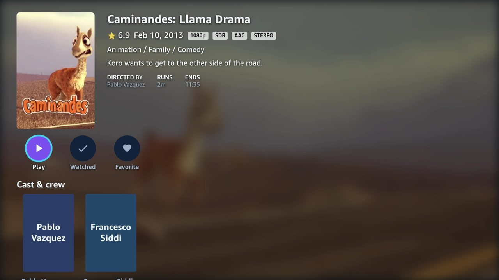
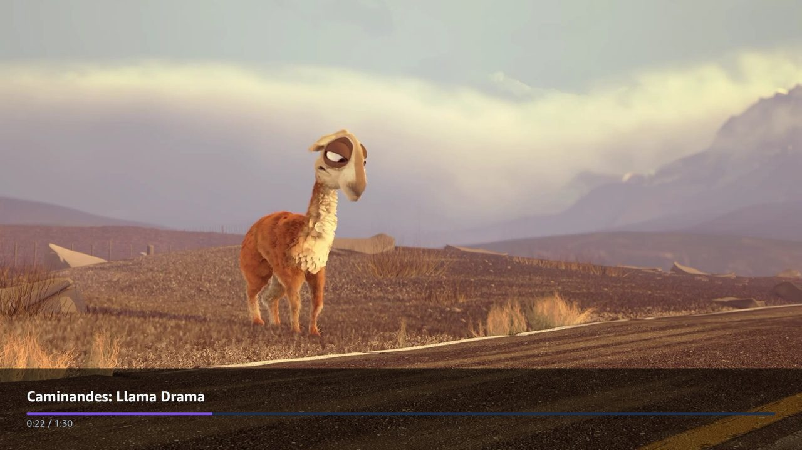
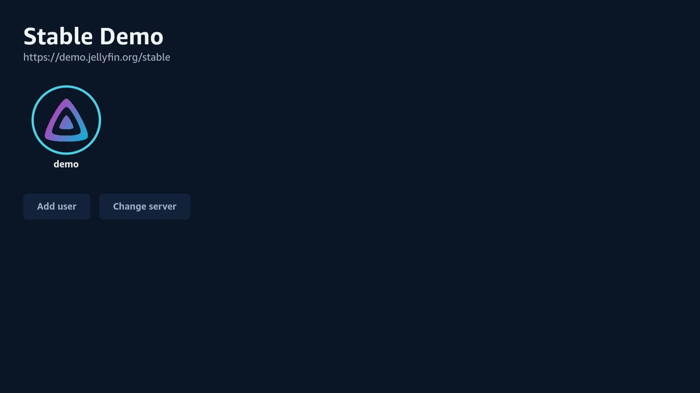
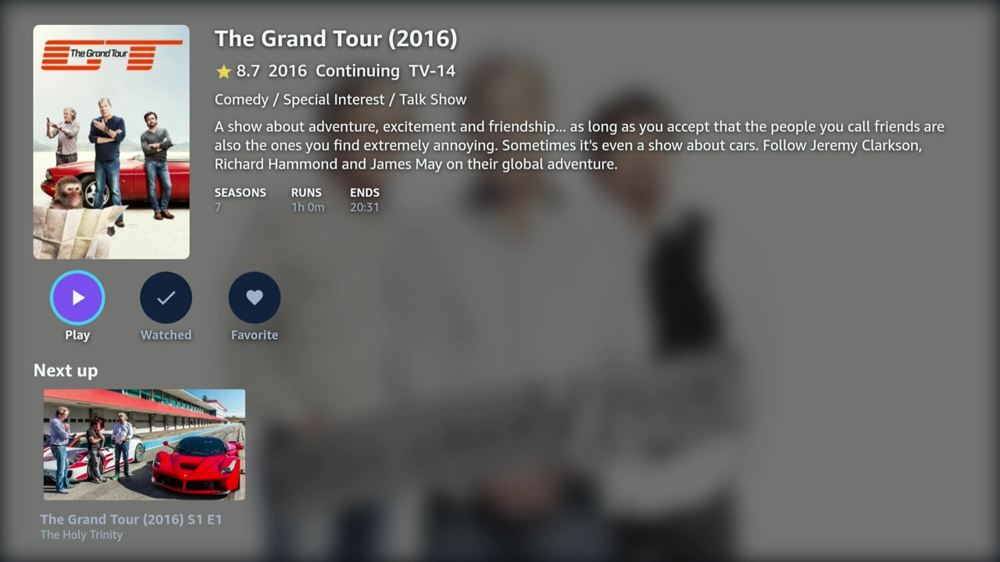
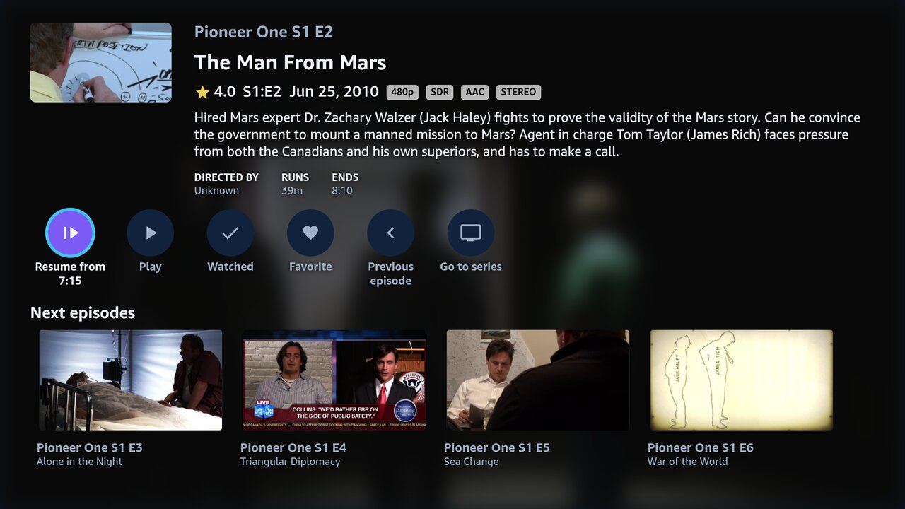

<p align="center">
  
</p>

<h1 align="center">Caravela</h1>

<p align="center">
  A Jellyfin client for Fire TV on Vega OS, for your movies and TV shows.
</p>

<p align="center">
  <a href="LICENSE"></a>
  
  
  
</p>

<p align="center">
  <a href="https://www.buymeacoffee.com/melojms"></a>
</p>

<p align="center">
  <sub>Caravela is an unofficial client that works with Jellyfin servers; it is not affiliated with the Jellyfin project.</sub>
</p>

## Screenshots

<table>
  <tr>
    <td width="50%"></td>
    <td width="50%"></td>
  </tr>
  <tr>
    <td align="center">Home</td>
    <td align="center">Movie details</td>
  </tr>
  <tr>
    <td width="50%"></td>
    <td width="50%"></td>
  </tr>
  <tr>
    <td align="center">Player, paused</td>
    <td align="center">Sign-in: the user picker</td>
  </tr>
  <tr>
    <td width="50%"></td>
    <td width="50%"></td>
  </tr>
  <tr>
    <td align="center">Series details</td>
    <td align="center">Episode details</td>
  </tr>
</table>

<p align="center"><sub>Content from the <a href="https://demo.jellyfin.org/stable">Jellyfin demo server</a>.</sub></p>

## Status

> [!NOTE]
> Caravela is a **work in progress**. It isn't on the Amazon Appstore yet; for now you build it yourself and sideload it onto a Fire TV in developer mode.

What works today:

- Sign-in with Quick Connect or a password, with several saved servers and users.
- Home rows from your server (My media, Continue watching, Next up, Recently added).
- Library grids for Movies and Shows, with sorting, filters and a letter picker shared with the official Android TV app.
- Details pages for movies, series, seasons, episodes and people: cast and crew, seasons and episodes, next up, similar titles, watched and favourite toggles.
- Playback: direct play, or the server's remux/transcode over HLS with Shaka Player. Resume points and playback progress are reported back to Jellyfin. Sending the app to the background (Home, another app, the screensaver) leaves the player, which stops playback and saves the position.
- Subtitles (drawn by the app, or burned in by the server for ASS and PGS) and audio track switching.
- Player controls: a seek bar with trickplay previews, chapters, skip back and forward (also from the remote's rewind and fast-forward keys), playback speed and zoom.
- Search for movies, shows and episodes (no voice search or search history yet).
- An About page in Settings: the app version and build, the server and its Jellyfin version, the licence, source and privacy policy, and the full licence texts of the third-party packages the app ships.

Coming next, roughly in this order:

- Intro skip, autoplay of the next episode and Next up
- Settings

## Features

- Made for the remote: D-pad focus, a top toolbar and Back that behaves like the official Android TV app.
- Looks and feels like Jellyfin's Android TV client, with the focused item's backdrop behind Home.
- Search across your libraries for movies, shows and episodes, with results as you type.
- Quick Connect sign-in by default, so you don't type a password with the remote.
- Several servers and users, with auto-login off, for the last user or for a specific one.
- About in Settings shows the app's version and build number and the server's name and Jellyfin version, handy for bug reports, and lists the third-party packages with their full licence texts.
- Plays what the Fire TV can handle directly and asks the server to remux or transcode the rest.
- Free software under GPL-2.0-or-later.

## Requirements

- Vega SDK 0.24 (`vega` CLI on your `PATH`)
- Node.js ≥ 22.14
- A Fire TV running Vega OS with developer mode on, or the Vega Virtual Device

## Build and run

Set up [Shaka Player](#shaka-player-not-included) first; the app won't build without it.

```sh
npm install
npm run lint
npm test

# Debug build (packages land in build/<arch>-debug/)
npm run build:debug

# Install and launch on the connected device
vega device list
vega device install-app --dir . -b Debug
vega device launch-app --dir .
```

Debug builds load JavaScript from the Metro dev server, so run `npm start` and forward its port to the device first (see the Vega Fast Refresh docs); without it the app starts blank. Release builds bundle the JavaScript and run on their own.

Use `npm run build:release` and `-b Release` for a release build. With more than one device connected, pass `--device <serial>` to the `vega device` commands.

The third-party licences screen (Settings → About) reads `src/about/licenses.json`, the third-party packages in the Release bundle with their licence texts. After changing dependencies, and before a release, regenerate it and commit the result:

```sh
npm run build:release   # the generator reads the bundle's source map from build/
npm run licenses
```

`npm test` fails when a runtime dependency is missing from the file.

## Shaka Player (not included)

Caravela plays transcoded and remuxed streams (HLS) with Amazon's Vega port of [Shaka Player](https://github.com/shaka-project/shaka-player). **This repository does not include it**, and the app won't build without it:

- Shaka Player itself is Apache-2.0, but Amazon's Vega package also ships polyfills marked "Amazon proprietary/confidential", under Amazon's own licence terms. Those files can't be committed to a GPL repository.
- So each checkout downloads and builds the package locally, and `scripts/setup-shaka.sh` copies the build and the polyfills into `src/vendor/shaka/`, which git ignores.

Set it up once per checkout. It needs Git, Python 3, Java 21+ and Node.js; the build clones upstream Shaka 4.16.13 from GitHub and applies Amazon's patches.

```sh
# Outside the app directory
mkdir -p ../shaka-build && cd ../shaka-build
curl -fLO https://amzndevresources.com/vega/media-player/shaka-rel-v4.16.13-r1.2-devices_scope.tar.gz
tar -xzf shaka-rel-v4.16.13-r1.2-devices_scope.tar.gz
shaka-rel/scripts/setup.sh

# Back in the app directory
scripts/setup-shaka.sh ../shaka-build/shaka-rel
```

Amazon describes the package and its build in [Play adaptive content with Shaka Player](https://developer.amazon.com/docs/vega/latest/media-player-shaka-player.html). Downloading it means accepting Amazon's terms for it.

**If you distribute builds:** a built app contains Amazon's proprietary polyfills, which the GPL doesn't cover. Caravela's licence has a linking exception ([LICENSE-EXCEPTION.md](LICENSE-EXCEPTION.md)) that allows this combination on the GPL side, but Amazon's terms still apply to Amazon's files, so check them before you share or publish a build.

## Releases

There are no public downloads. Every build contains Amazon's proprietary Shaka polyfills (see above), so to run Caravela, build it yourself.

For maintainers, the **Release** workflow (`.github/workflows/release.yml`) builds a release package for the Fire TV Stick 4K Select (armv7):

1. In **Actions → Release → Run workflow**, pick a version bump (`patch`, `minor` or `major`), or run `gh workflow run release.yml -f bump=patch`.
2. The workflow bumps the version in `manifest.toml` and `package.json`, installs the Vega SDK, builds Shaka Player, then lints, tests and builds. Only if all of that passes does it commit `Release vX.Y.Z` to `main` and push the `vX.Y.Z` tag.
3. It attaches `caravela-vX.Y.Z-armv7.vpkg` to a **draft** release, which only people with write access to the repository can see.

Install a release on the device:

```sh
gh release download v0.1.1 --pattern '*.vpkg'
vega device install-app --packagePath caravela-v0.1.1-armv7.vpkg
```

Leave releases as drafts. Publishing one would make the package, and Amazon's polyfills inside it, publicly downloadable.

## Jellyfin API and saved logins

- **SDK:** `@jellyfin/sdk` 1.0.0, generated from the Jellyfin 12.0 OpenAPI spec. Caravela supports **Jellyfin 12.0 and newer** and rejects older servers when you add them. The SDK and its axios dependency bundle and run under Vega Metro/Hermes (axios uses its `react-native` build).
- **URL polyfill:** Vega's built-in `URL` has no `search` setter, but the SDK's generated client sets `url.search` on every request. `src/api/urlPolyfill.js` replaces the global `URL` and `URLSearchParams` with core-js's versions, and `index.js` imports it first. `react-native-url-polyfill` doesn't work on Vega because it reads `NativeModules.BlobModule` on load, which crashes the bridgeless RN 0.83 runtime.
- **Tokens in URLs:** URLs the app builds for the player, trickplay sheets and avatars carry the token as `ApiKey` (Jellyfin's own spelling). A Jellyfin 12.2 server rejects `api_key` with a 401.
- **Storage:** servers, users, tokens and the auto-login setting are saved as one JSON entry in AsyncStorage, using Vega's port `@amazon-devices/react-native-async-storage__async-storage` ~2.1. Vega has no secure key/value store for apps, so **access tokens are stored unencrypted** in the app's sandboxed SQLite database. The store sits behind the `AuthStore` interface, so it can move to secure storage if Vega adds one.

## Support

Caravela is a spare-time project. If it's useful to you and you'd like to help it along, you can buy me a coffee. Bug reports and ideas in the issues are just as welcome.

<p>
  <a href="https://www.buymeacoffee.com/melojms"></a>
</p>

## License

GPL-2.0-or-later: you can redistribute and modify Caravela under the terms of the GNU General Public License, version 2 or (at your option) any later version. See [LICENSE](LICENSE). As an additional permission, Caravela may be combined and distributed with Amazon's Vega media libraries and its Shaka Player port; see [LICENSE-EXCEPTION.md](LICENSE-EXCEPTION.md). Amazon's Shaka Player polyfills aren't part of this repository and aren't covered by this licence; see [Shaka Player (not included)](#shaka-player-not-included).
